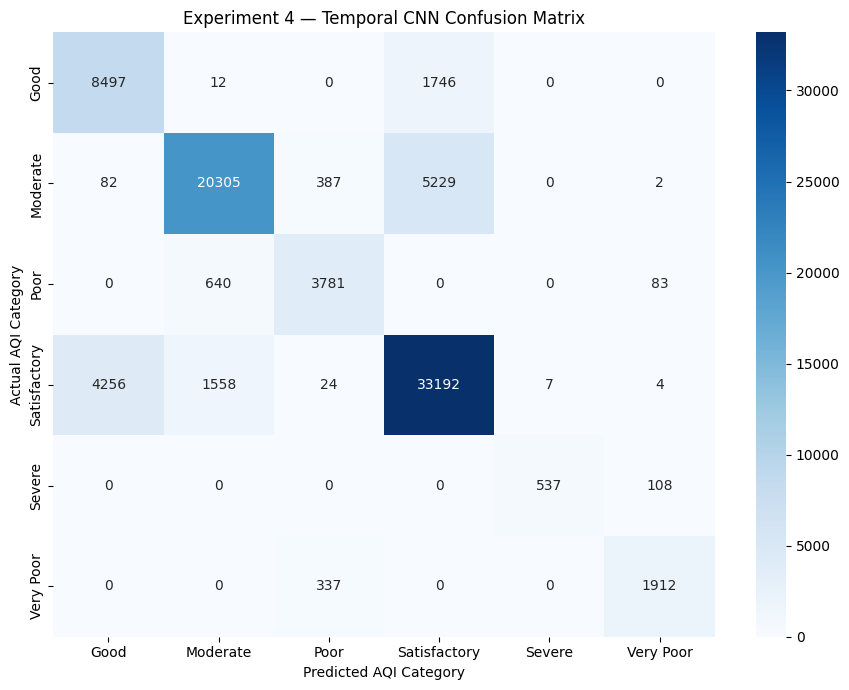
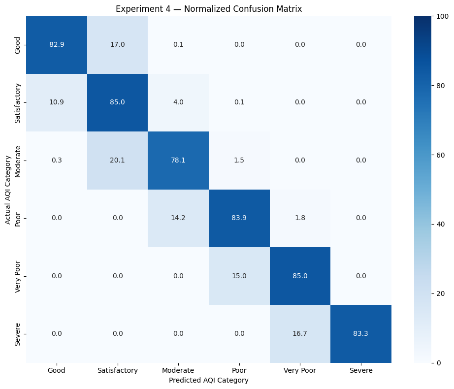

AQI Analytics Lab
A Comparative Study of Machine Learning Approaches for Air Quality Index Classification
AQI Analytics Lab is a research-oriented project exploring how classical machine learning and temporal deep learning approaches can classify air-quality categories from historical pollutant measurements across Indian cities.
The project is organized as five experimental stages, moving from classical baselines and imbalance handling to feature analysis, next-hour temporal prediction, and cross-city generalization. A Streamlit dashboard presents the recorded results, evaluation visualizations, and methodological limitations in one place.
> **Important:** This is a research-results dashboard. It displays saved experimental results; it is not a live AQI monitoring service and does not perform real-time inference.
---
Table of Contents
Research Objectives
Project Highlights
Dataset Overview
Experimental Study
Experiment 4: Temporal CNN
Experiment 5: Cross-City Generalization
City-Wise Evaluation
Methodology and Limitations
Dashboard Preview
Project Structure
Installation and Usage
Technology Stack
Reproducibility Notes
---
Research Objectives
The study investigates the following questions:
How do classical machine learning models perform on AQI-category classification?
How do class-imbalance strategies affect overall and class-balanced performance?
Which pollutant features contribute most to classification performance in the tested feature configurations?
Can a temporal model use the preceding 24 hours of pollutant measurements to predict the next-hour AQI category?
How well does the temporal approach generalize to cities excluded from model training?
Project Highlights
707,875 hourly observations across 26 cities in the source dataset.
Seven pollutant input features: PM2.5, PM10, NO2, SO2, CO, O3, and NH3.
Five experimental stages covering classical ML, imbalance handling, feature analysis, temporal modelling, and cross-city evaluation.
A corrected Temporal CNN evaluation using chronological, city-specific splitting and training-only scaler fitting.
Raw-count and normalized confusion matrices for Experiment 4.
City-wise performance summaries across 23 retained cities.
An interactive Streamlit dashboard with an animated landing page and dedicated research sections.
---
Dataset Overview
The project uses an hourly air-quality dataset named `city_hour.csv`.
Attribute	Description
Observations	707,875
Cities in source dataset	26
Cities retained for the temporal evaluation	23
Selected pollutant features	7
Target	AQI category / AQI bucket
Duplicate city–datetime pairs	0
Missingness across selected features (reported)	23.76%
Selected pollutant features
PM2.5
PM10
NO2
SO2
CO
O3
NH3
The target is the categorical AQI bucket. The source dataset contains the categories Good, Satisfactory, Moderate, Poor, Very Poor, and Severe.
Dataset source: Add the original dataset citation or download link here before publishing. The dataset itself is not included in this repository.
---
Experimental Study
The project is divided into five experiments. The results below are the recorded outputs of their respective experimental pipelines.
Experiment 1 — Classical Machine Learning
Objective: Establish baseline performance using classical classification algorithms.
Models evaluated:
K-Nearest Neighbors (KNN)
Logistic Regression
Support Vector Machine (SVM)
Random Forest
XGBoost
The reported best result was obtained using Random Forest.
Model / setup	Accuracy	Macro-F1	Balanced accuracy
Random Forest	60.38%	0.5024	0.4963
Methodological note: This historical baseline used forward/backward filling before splitting and a chronological split. It should not be treated as directly comparable to the corrected Temporal CNN pipeline.
Experiment 2 — Class-Imbalance Handling
Objective: Investigate the effect of class-imbalance strategies.
The experiment compared:
Baseline XGBoost
Class-weighted Random Forest
XGBoost with SMOTE
SMOTE was applied only to the training data.
Model / setup	Accuracy	Macro-F1	Balanced accuracy

Baseline XGBoost	59.31%	0.4993	0.5006
Class-weighted Random Forest	60.45%	0.4965	0.4809
XGBoost + SMOTE	55.10%	0.4970	0.5439
The SMOTE-based XGBoost result had the highest balanced accuracy among these reported configurations, while its overall accuracy was lower.
Methodological note: Different models and configurations were used across the rows. This is not a perfectly isolated comparison of imbalance-handling methods.
Experiment 3 — Feature Contribution Analysis
Objective: Examine the contribution of the seven pollutant features.
The full seven-feature configuration achieved 73.02% accuracy.
Reported accuracy reductions after removing one feature at a time:
Removed feature	Accuracy change
CO	-2.86 percentage points
O3	-2.81 percentage points
PM2.5	-2.64 percentage points
PM10	-2.40 percentage points
NH3	-2.16 percentage points
NO2	-1.90 percentage points
SO2	-1.65 percentage points
The full-feature configuration outperformed the tested gas-only and particulate-only groups.
Methodological note: This experiment used a different stratified split and a globally filled dataset. Macro-F1 and balanced accuracy are not reported for this experiment in the dashboard and are therefore intentionally omitted here.
Experiment 4 — Temporal CNN
Objective: Use a sequence of historical pollutant measurements to predict the next-hour AQI category.
Metric	Result
Accuracy	82.50%
Macro-F1	0.8382
Balanced accuracy	0.8303
Configuration and data preparation:
Input window: 24 hours
Prediction target: next-hour AQI category
Seven pollutant features
Per-city forward-only imputation, capped at 24 hours
City-specific chronological 80/20 split
Scaler fitted on the training period only
Valid contiguous 24-hour sequences
Recorded sequence statistics:
Quantity	Count
Retained records	339,117
Training sequences	239,959
Test sequences	82,699
Class-wise classification report
AQI category	Precision	Recall	F1-score	Support
Good	0.66	0.83	0.74	10,255
Moderate	0.90	0.78	0.84	26,005
Poor	0.83	0.84	0.84	4,504
Satisfactory	0.83	0.85	0.84	39,041
Severe	0.99	0.83	0.90	645
Very Poor	0.91	0.85	0.88	2,249
Confusion matrices
The dashboard includes the original Experiment 4 confusion-matrix visualizations:
Raw-count confusion matrix

Normalized confusion matrix

The two source visualizations retain their original class-axis orders. The raw-count matrix uses the order Good, Moderate, Poor, Satisfactory, Severe, Very Poor. The normalized matrix uses Good, Satisfactory, Moderate, Poor, Very Poor, Severe. Their axes should not be assumed to share the same order.
The normalized diagonal values indicate class-wise recalls of approximately 82.9% (Good), 85.0% (Satisfactory), 78.1% (Moderate), 83.9% (Poor), 85.0% (Very Poor), and 83.3% (Severe), in the normalized matrix's displayed order.
Experiment 5 — Cross-City Generalization
Objective: Evaluate performance on cities held out from training.
Held-out cities:
Kochi
Delhi
Aizawl
Coimbatore
Mumbai
Metric	Result
Accuracy	74.42%
Macro-F1	0.6846
Balanced accuracy	0.7570
Recorded data statistics:
Quantity	Count
Training records	245,045
Held-out records	60,852
Training sequences	56,514
Test sequences	18,194
This experiment used complete-case records, a scaler fitted on training cities only, and 24-hour sequences with stride 3.
Methodological note: Experiment 5 is a separate generalization experiment. It uses a different data protocol from Experiment 4 and should not be directly equated with the city-specific chronological evaluation.
---
City-Wise Evaluation
The dashboard reports city-wise test performance for 23 retained cities, including:
Accuracy
Macro-F1
Balanced accuracy
Number of test sequences
Number of actual AQI classes represented in the test subset
Aizawl is retained in the city table and sample-count chart, but is excluded from the multiclass Macro-F1 comparison. Its test subset contains only one actual class (Good), so its displayed 100% accuracy and Macro-F1 do not establish multiclass classification ability. Balanced accuracy is undefined for this single-class subset.
City-wise metrics should be interpreted alongside each city's test sample count and class distribution. A high score from a small or single-class subset is not necessarily evidence of stronger generalization.
---
Methodology and Limitations
The five experiments do not share one identical preprocessing and evaluation pipeline.
Key interpretation boundaries:
The historical classical baseline used forward/backward filling before splitting.
The feature-analysis experiment used a different stratified split and globally filled data.
Experiment 4 used capped per-city forward-only imputation, city-specific chronological splitting, and training-only scaler fitting.
Experiment 5 used complete-case records and held out entire cities.
Experiment 2 compared different model configurations, so its rows do not isolate only the effect of the resampling or weighting strategy.
City-wise performance varies with sample size and class distribution.
Aizawl's single-class test subset cannot support a meaningful multiclass performance claim.
The dashboard presents saved experimental results; it does not run live AQI inference.
For these reasons, the experiment comparison chart is a summary of reported results, not a strictly controlled model leaderboard.
---
Dashboard Preview
The Streamlit application includes:
Animated landing page — introduces the research study.
Overview — dataset summary and experimental journey.
Experiment comparison — accuracy comparison and detailed result table.
Temporal CNN — model metrics, configuration, classification report, and confusion matrices.
City-wise evaluation — city selector, performance table, accuracy, Macro-F1, and test-sample charts.
Methodology & limitations — experimental protocols and interpretation notes.
Add dashboard screenshots to a `screenshots/` directory and link them here when preparing the public repository. Suggested files:
```text
screenshots/
├── landing-page.png
├── overview.png
├── experiment-comparison.png
├── temporal-cnn.png
├── confusion-matrices.png
├── city-wise-evaluation.png
└── methodology.png
```
---
Project Structure
```text
aqi_dashboard/
├── app.py
├── requirements.txt
├── README.md
├── .gitignore
└── results/
    ├── experiment4_confusion_matrix.png
    └── experiment4_normalized_confusion_matrix.png
```
The `.venv/` environment directory is local and should not be committed to GitHub.
---
Installation and Usage
1. Clone the repository
```bash
git clone <YOUR_GITHUB_REPOSITORY_URL>
cd aqi_dashboard
```
2. Create and activate a virtual environment
Windows PowerShell
```powershell
python -m venv .venv
.venv\Scripts\Activate.ps1
```
macOS / Linux
```bash
python3 -m venv .venv
source .venv/bin/activate
```
3. Install dependencies
```bash
pip install -r requirements.txt
```
4. Run the dashboard
```bash
streamlit run app.py
```
Streamlit will provide a local URL, typically:
```text
http://localhost:8501
```
Requirements
The dashboard uses:
Streamlit
Pandas
Plotly
The raw dataset is not required to open the dashboard because the application displays recorded results embedded in the app and the saved confusion-matrix images.
---
Technology Stack
Technology	Role
Python	Application and data handling
Streamlit	Interactive research dashboard
Pandas	Result tables and city-wise data
Plotly Express	Interactive charts
HTML / CSS	Animated landing page and visual styling
Classical ML / XGBoost	Experiments 1–3
Temporal CNN	Experiments 4–5
---
Reproducibility Notes
This repository currently packages the Streamlit dashboard, the recorded result summaries embedded in `app.py`, and the two Experiment 4 confusion-matrix images.
The raw dataset and the original model-training notebooks/scripts are not included in the current project folder. Consequently, the dashboard can be run from this repository, but the model experiments cannot yet be independently retrained from this repository alone.
For a fully reproducible research release, add the cleaned experiment notebooks or training scripts, exact dataset citation/access instructions, and any required environment details. Do not commit private, restricted, or very large raw data files; document how an authorized user can obtain the dataset instead.
---
Responsible Interpretation
The reported metrics describe the specific datasets, splits, and evaluation protocols used in each experiment. They should not be interpreted as a guarantee of real-world AQI prediction performance or as evidence that all five experiments are directly comparable.
The aim of this project is to document and examine a sequence of machine-learning experiments while making their evaluation choices and limitations visible.